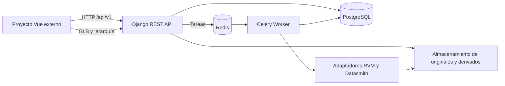

# Arquitectura del Microservicio Industrial 3D

Este repositorio contiene la API y los workers de conversión. El cliente web se desarrolla y despliega en otro proyecto, que consume el contrato OpenAPI del servicio.

## Componentes

- **API:** Django REST Framework ofrece proyectos, activos, versiones, subidas reanudables, trabajos y herramientas de modelo. OpenAPI está disponible en `/api/schema/` y `/api/docs/`.
- **Persistencia:** PostgreSQL en Docker Compose y SQLite para desarrollo local sin `DB_NAME`.
- **Almacenamiento:** originales inmutables, fragmentos temporales y artefactos derivados bajo `STORAGE_ROOT`.
- **Procesamiento:** Celery ejecuta tareas asíncronas a través de Redis.
- **Conversión:** adaptadores desacoplados para RVM y Datasmith. El runtime de RVM debe configurarse en el entorno de ejecución.

El proyecto cliente es responsable de la interfaz y debe configurar el origen permitido en `CORS_ALLOWED_ORIGINS` y consumir la URL base de la API.
